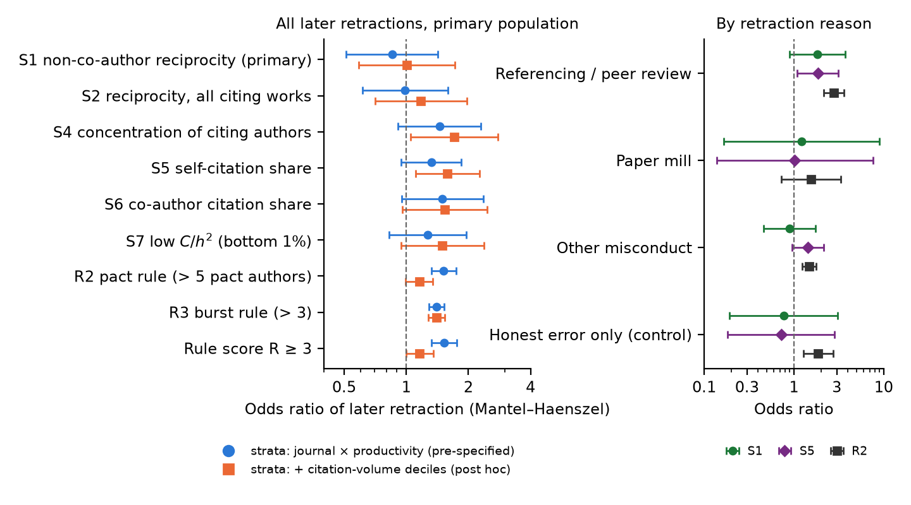
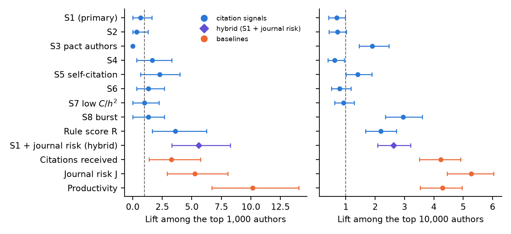

<h1 align="center">Do author-level citation-ring signals predict later retractions?</h1>

  <em>An out-of-sample test on the open biomedical citation graph</em>

  
  
  
  
  

Companion repository to the paper by **Hossein Mohasel Arjomandi** (preprint). It holds the code, the design
specification and the post hoc plan with their hashes, every run record with checksums, a map from each number in the
paper to the run that produced it. The LaTeX source of the paper is added when the preprint is posted. **No author
names, ORCID iDs or per-author scores are included**, by design.

## In one paragraph

Author-level citation signals (citation exchange between authors, concentration of citing authors, self- and co-author
citation) have been proposed for detecting citation manipulation and are packaged in screening tools, but ring-type
signals had not been tested against retractions issued after they were measured. Here they are computed for **793,299 ORCID-identified biomedical
authors** from the **January 2024** OpenCitations graph, **frozen with a hash**, and only then compared with Retraction
Watch retractions issued **February 2024 – October 2026**, within strata of main journal and productivity. The design was
specified before any score was computed; analyses added later are labelled post hoc, with each plan written before it ran.

## Results at a glance

| | |
|---|---|
| Authors in the primary population / with a later retraction | **793,299** / **2,419** (0.305%) |
| Top 1% of non-co-author reciprocity (primary): odds ratio | **0.85** (95% CI 0.51–1.43): not associated |
| Other top-1% signals (reciprocity, concentration, self-citation, co-author citation, low C/h²) | all intervals include 1 in the primary analysis; with citation-volume deciles added (post hoc), concentration 1.71 (1.05–2.78) and self-citation 1.59 (1.11–2.26), but concentration's lift at 10,000 is 0.62 (no better than chance) |
| Pact rule (> 5 reciprocal citing authors, adapted from a screening tool) | 1.52 (1.32–1.75) |
| Pact rule with citation-volume deciles in the strata (post hoc) | 1.16 (0.99–1.35) |
| Pact rule in the finest strata (post hoc): referencing/peer-review vs honest-error retractions | 1.85 (1.34–2.55) vs 1.62 (1.03–2.55); ratio 1.14 (0.63–1.94): not shown to be specific |
| Primary estimate with intervals clustered by journal / by shared retracted publications (post hoc) | 0.85 (0.41–1.35) / (0.42–1.42) |
| Lift among the top 1,000 authors: reciprocity / journal risk / productivity | 0.66 / 5.25 / 10.17 |
| Biomedical author positions with an ORCID iD (2014–2023) | 23.8% (20–27% by year) |
| Later retractions also attributed through Crossref ORCID iDs (post hoc) | 19 more positives (2,419 → 2,438); no odds ratio moves by more than 0.12 |
| Retractions of the citation network announced by Frontiers in 2025 (post hoc) | 4 of 124 list an ORCID iD in OpenCitations Meta, none in Crossref: open data cannot attach them |

Every number above is traced in [`FINDINGS.md`](FINDINGS.md).

  

  

## What is in here

| Path | Contents |
|---|---|
| `SPEC.md` | The pre-specified design (frozen v1; SHA-256 in `experiments/f04_spec/RESULTS_LOG.md`) |
| `POSTHOC.md` | Post hoc plans, each written before its run |
| `FINDINGS.md` | Every claim in the paper → number → run |
| `REPRODUCE.md` | Inputs, environment, exact commands in run order, runs not cited |
| `experiments/` | One folder per step: scripts, lab notebook `RESULTS_LOG.md`, `runs/<run_id>/` with `run.json`, `stdout.log`, aggregate outputs and `SHA256SUMS`. One record, `f17_attribution_20261126_01`, is released redacted (`REDACTED.md`): it profiled a single author |
| `lit/` | Literature gate with every DOI verified (`LIT.md`, `doi_check_20261126.tsv`) |
| `paper/` | LaTeX source, figures, references and the number tracer (added when the preprint is posted) |
| `vm/` | VM control script and the environment lock file |

## Provenance of the design
This repository was created on 26 November 2026, after the analyses, so its history does not time-stamp the design. The
order of steps is documented by the project's own records: the specification's SHA-256 hash
(`07200ecb9affa9f2bee88b68becba9ad81900d2cfcc1fc759ba814ced61ca3ec`) is stored in the record of the frozen score run
(`experiments/f05_scores/runs/f05_scores_20261126_01/run.json`, started 18:43:21 UTC) and of the evaluation run, the
first to link scores to outcome labels (`experiments/f06_eval/runs/f06_eval_20261126_02/run.json`, 18:54:42 UTC), which refuses
to run if the specification has changed; see `experiments/f04_spec/RESULTS_LOG.md`. No third party time-stamped the
specification before the evaluation; GitHub's own record dates the first push to this repository at 21:24:18 UTC, after the
evaluation. The study is pre-specified, not pre-registered. The order of all steps is drawn in
`experiments/f18_design/runs/f18_design_20261126_02/fig_timeline.png`.

## Data
All inputs are open: the parsed OpenCitations snapshot (Illinois Data Bank, doi:10.13012/B2IDB-5216575_V1), the
OpenCitations Meta CSV dump (doi:10.6084/m9.figshare.21747461.v7), the Retraction Watch database distributed by Crossref
(commit a98cc7e), and the PubMed 2026 baseline (U.S. National Library of Medicine). Per-author tables are not released:
a score could be mistaken for an integrity label of a named person. Retraction is not proof of misconduct, and an
anomalous citation pattern is not evidence of manipulation.

## Licences
Code: MIT (`LICENSE`). Run records, aggregate tables, figures and documentation: CC BY 4.0 (`LICENSE-DATA`).
